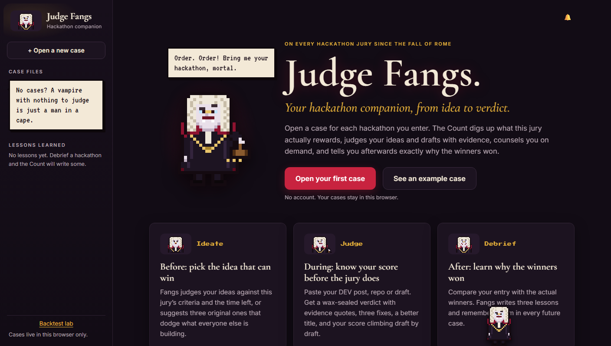
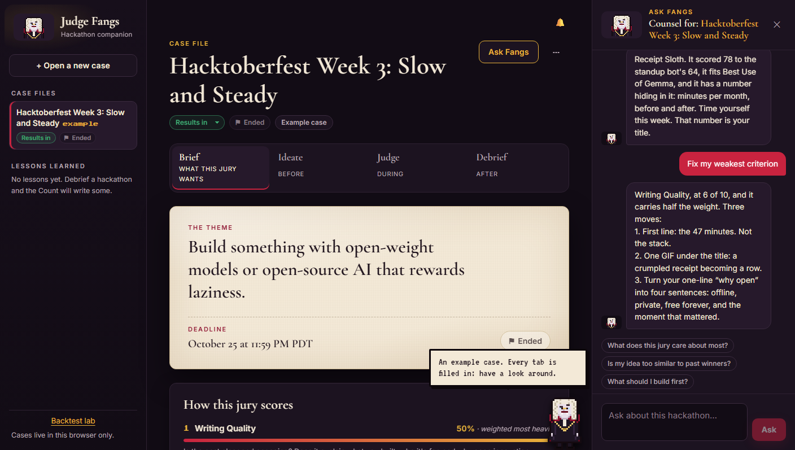
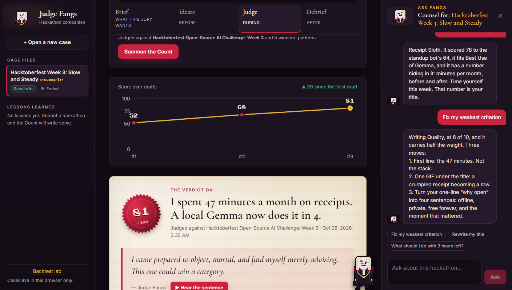
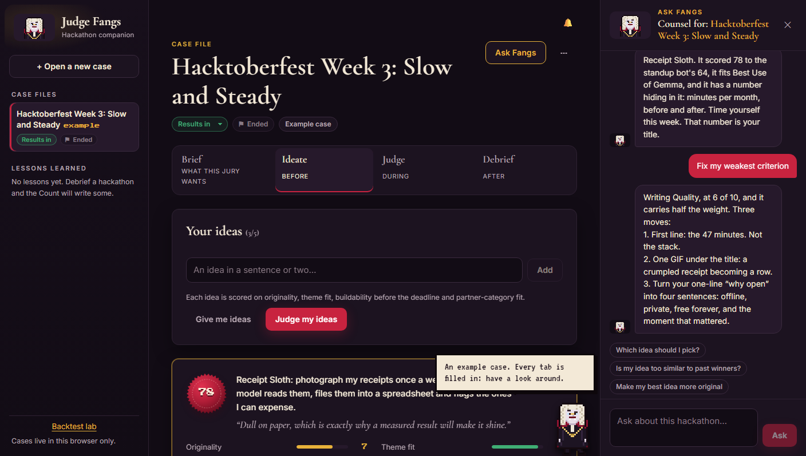
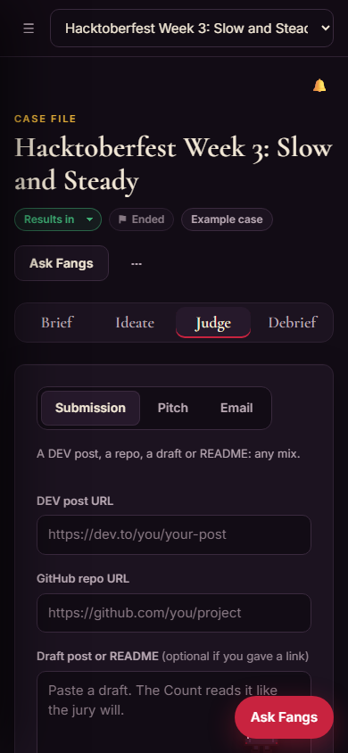

# Judge Fangs

**Your hackathon companion, from idea to verdict.** A strict, funny, 3,000-year-old vampire judge who has sat on every hackathon jury since the fall of Rome, and who now sits beside you through the whole hackathon.

> "I have watched empires fall with more structure than your README. Three fixes. Then we shall speak again."

Open a **case file** for each hackathon you enter: paste its URL or just type its name. The Count digs up the theme, the judging criteria in order of weight, the prize categories, the deadline and what past winners had in common. Then each case follows the hackathon timeline:

| Tab | When | What Fangs does |
|---|---|---|
| **Brief** | before | The case file: the theme in one line, weighted criteria, prize categories, a deadline countdown, "what winners usually have", and the sources he read |
| **Ideate** | before | Judges up to 5 ideas on originality, theme fit, buildability before the deadline and partner-category fit, with "How it could win". **Give me ideas** suggests 3 original ones that avoid what's already common. Star ideas, and choose one: it becomes context everywhere else |
| **Judge** | during | The full review of any mix of a DEV post, a GitHub repo and pasted text (or a pitch or an email): a wax-sealed verdict with evidence quotes, 3 fixes, a better title and opening. Every draft is kept, so a small chart shows your score climbing |
| **Debrief** | after | Mark the result, paste the winners post, and he compares your entry with the real winners: what they did that you didn't, what you did well, and **3 lessons** |

Lessons are remembered across all cases ("Lessons learned" in the sidebar) and fed into future Ideate, Judge and chat prompts. **Ask Fangs** is a chat drawer, available in every tab, with counsel specific to the case: its criteria, deadline, chosen idea and latest verdict.

**See an example case** loads a fully populated case built from the real Hacktoberfest Week 3 ("Slow and Steady") brief and winners, with no API calls needed. The brief, prize categories, deadline, winners and sources come from a live dig of the real posts. The entry itself ("Receipt Sloth") and its drafts are fictional.

Also included: a **Backtest lab** (would the Count have picked the real winners?) and a **desktop companion** (<kbd>Ctrl</kbd>+<kbd>Shift</kbd>+<kbd>J</kbd> anywhere and he judges what's on your screen).

**Live:** https://fangs-web.onrender.com (API: https://fangs-api.onrender.com). Replace these with your Render URLs.



| A case file (Brief + Ask Fangs) | Judge: score history and the verdict |
|---|---|
|  |  |
| **Ideate** | **On a phone** |
|  |  |

Judge Fangs is an original character, drawn as 32×32 pixel arrays in code (`shared/fangs-sprite.js`). There are no image files and no borrowed sprites.

## The API

| Route | What it does |
|---|---|
| `POST /api/case/stream` | Open a case (SSE): dig the brief from a URL, a name (searched with SerpApi) or pasted text, plus the winners' patterns |
| `POST /api/review/stream`, `POST /api/review` | The dig → check → judge review. Inside a case, the brief and patterns are passed in, so he doesn't dig again |
| `POST /api/chat` | Ask Fangs. The browser sends a compact case context (capped at 6,000 characters; older messages summarised to one line each) plus the last 10 messages |
| `POST /api/ideas` | `mode: "judge"` scores up to 5 ideas; `mode: "generate"` suggests 3 |
| `POST /api/debrief` | Compares the final submission with the real winners and writes 3 lessons |
| `POST /api/voice`, `POST /api/judge-screen`, `/api/backtest/*` | "Hear the sentence", the desktop companion, the backtest |

Every route has per-IP rate limits, counts toward the daily caps, and answers from `app/demo/` in demo mode. Chat, idea and debrief text never goes to Sentry: only lengths, labels and timings do.

## How it works: dig → check → judge

```
 browser (React static site)              fangs-api (FastAPI on Render)                    outside world
 ───────────────────────────              ─────────────────────────────                    ─────────────
 ModePicker / ReviewForm ──POST──▶ /api/review/stream (SSE) ──┐
 DigLog ◀── "Fetching the challenge rules…" ◀─────────────────┤
                                       1. DIG    fetchers.py ──┼──▶ dev.to API  (posts, challenge pages, winners)
                                                               ├──▶ api.github.com + raw.githubusercontent.com
                                                               ├──▶ serpapi.com (optional: find the winners post)
                                                               └──▶ model: extract criteria · summarise winners' patterns
                                       2. CHECK  checks.py      (no AI) partner claims vs code, post facts
                                       3. JUDGE  judge.py ─────────▶ model: one judging call, strict JSON
                                                 guard rails: exact-quote check, clamped scores, code-check overrules
 VerdictCard ◀── verdict ──────────────┘
 "Hear the sentence" ──▶ /api/voice ──────────────────────────────▶ ElevenLabs (verdict line only)
```

1. **Dig.** The server fetches public sources only: DEV posts through the public DEV API (`/api/articles/{user}/{slug}`), and GitHub repos through the GitHub API. For a repo it reads the README, the file tree (top 2 levels), the manifests (`package.json`, `requirements.txt`…), the languages, the commit count, whether there's a CI workflow, and a few telling source files. For the hackathon page, the model extracts the judging criteria in order of weight, the prize categories, the deadline and what the theme asks for. If you paste a winners announcement (or `SERPAPI_KEY` finds one), it reads up to 5 winning posts and summarises what they had in common. Every source is capped at 12,000 characters and listed, with links, under the verdict.
2. **Check (no AI).** The code checks find the prize categories your post claims (for example "Best Use of Sentry"). They then scan the repo's dependencies, imports, env var names and config files for evidence. Each claim is **backed by code**, **mentioned only** (the repo's README names it, but there's no code) or **not found**. They also count facts about the post: word count, reading time, whether the title has a number, images, embedded videos, demo and repo links, and a "why open innovation matters" section. These facts go to the model and appear as **Evidence the Count gathered**.
3. **Judge.** One model call gets the criteria, the winners' patterns, the facts and your submission. It returns strict JSON: an overall score, a score, verdict and *exact* evidence quote per criterion, why you're not winning, exactly 3 fixes, a better title and opening, and his sentence in character. Then code guard rails apply:
   - An evidence quote that isn't really in your submission is struck and that criterion is marked **unsupported**.
   - Scores are clamped. The opening is capped at 60 words, and there are always exactly 3 fixes.
   - If the model says a partner tech is used but the code check found nothing: **"The Count's code check overruled the model."**
   - Below 50, he opens with his catchphrase: **"Objection. To all of it."**

The model gets every instruction in a single user message, because some Gemma providers reject a system role and JSON mode. Replies are parsed for JSON robustly. On failure he retries once with the error explained, then shows a graceful error.

## Modes

| Mode | Input | He scores | You get |
|---|---|---|---|
| Hackathon | challenge URL or brief, DEV post / repo / text, optional winners URL | the challenge's own criteria (or the standard DEV jury criteria) | the full verdict above |
| Email | the email, optional context | clarity, tone, the ask, length | a rewritten email, a better subject, 3 fixes |
| Idea | the idea, optional brief and winners/entries URL | originality, theme fit, buildability in the time left | the closest real competitors (only from entries you gave), 3 ways to sharpen it |

## Backtest (blind by design)

Paste up to 20 DEV post URLs and the hackathon URL, plus an optional winners URL (used for the brief and patterns only). The Count judges each one in turn, with a progress bar, and ranks them by overall score. He never sees which entries won: the posts being judged are **left out of the winners' patterns**, and the page says so. You paste the true winners afterwards. The page then reports how many real winners landed in his top N, and the average score of winners vs everyone else. CSV export: url, title, overall, each criterion score, winner label.

## Desktop companion (`desktop/`)

A thin Electron client. All AI and all keys stay on the API, and nothing runs a model on your laptop.

- <kbd>Ctrl</kbd>+<kbd>Shift</kbd>+<kbd>J</kbd> (<kbd>Cmd</kbd>+<kbd>Shift</kbd>+<kbd>J</kbd> on Mac) captures your screen, then opens a transparent, click-through, always-on-top overlay. The Count drops in from the top and walks along the bottom of the screen. Only his speech bubble catches clicks.
- He shows you a preview: **Judge this** or **Never mind**. Nothing is sent until you confirm.
- On confirm, the screenshot (≤1280 px, JPEG, ≤600 KB) goes to `POST /api/judge-screen`. The model reads it, works out what you're doing (a post, an email, an idea, code) and any visible challenge, then runs the same dig → check → judge pipeline.
- He answers in a pixel speech bubble (score, why it fails, 3 fixes), reads his sentence aloud, and offers **Open full verdict** in the web app. <kbd>Esc</kbd> or the shortcut dismisses him.

```bash
cd desktop
npm install
npm start            # API base from desktop/config.json, or FANGS_API_BASE / FANGS_WEB_BASE
npm run dist         # Windows portable .exe in desktop/dist (CI uploads it as an artifact)
```

## Run it locally

```bash
# API
python -m venv .venv && .venv/Scripts/activate    # (source .venv/bin/activate on macOS/Linux)
pip install -r requirements-dev.txt
cp .env.example .env    # optional; with no LLM_API_KEY it runs in demo mode
uvicorn app.main:app --reload --env-file .env      # http://127.0.0.1:8000

# Web (proxies /api to :8000 in dev)
cd web && npm install && npm run dev               # http://localhost:5173

# Tests
pytest -q
cd web && npm run build && npx vitest run
```

**Demo mode.** With no `LLM_API_KEY`, with `DEMO_MODE=true`, or once the caps are hit, the API serves 2 pre-computed example reviews (`app/demo/`), one strong and one weak, with a banner. The same two are bundled into the web app, so **See an example judgement** works even when the API is asleep.

## Environment variables (API)

| Variable | Needed? | Where to get it |
|---|---|---|
| `LLM_API_KEY` | for live reviews (otherwise demo mode) | Google AI Studio: https://aistudio.google.com/apikey |
| `LLM_BASE_URL` | no | default `https://generativelanguage.googleapis.com/v1beta/openai` |
| `LLM_MODEL` | no | default `gemma-4-31b-it` (the largest Gemma on AI Studio; it also reads images, which `/api/judge-screen` needs) |
| `ELEVENLABS_API_KEY` | for "Hear the sentence" | https://elevenlabs.io/app/settings/api-keys |
| `ELEVENLABS_VOICE_ID` | no | a deep, severe voice from https://elevenlabs.io/app/voice-library (default: a premade deep voice) |
| `GITHUB_TOKEN` | recommended | https://github.com/settings/tokens. A token with no scopes lifts the 60 requests/hour limit to 5,000 |
| `SERPAPI_KEY` | no | https://serpapi.com/manage-api-key, to find the winners post automatically |
| `SENTRY_DSN` | no | Sentry → Project Settings → Client Keys (DSN) |
| `WEB_ORIGIN` | set by the Blueprint | the static site's URL, for CORS |
| `DAILY_REVIEW_CAP`, `DAILY_VOICE_CAP` | no | global spending guards per UTC day (default 300 each) |
| `RATE_REVIEWS_PER_10M`, `RATE_BACKTEST_PER_10M`, `RATE_VOICE_PER_10M` | no | per-IP limits (defaults 6, 25, 12) |

The web app reads `VITE_API_BASE` at build time. The Blueprint sets it from the API service.

## Point it at another model

Change three env vars and nothing else:

| Provider | `LLM_BASE_URL` | `LLM_MODEL` | `LLM_API_KEY` |
|---|---|---|---|
| Google AI Studio (default) | `https://generativelanguage.googleapis.com/v1beta/openai` | `gemma-4-31b-it` | AI Studio key |
| OpenRouter | `https://openrouter.ai/api/v1` | `google/gemma-4-31b-it` | OpenRouter key |
| Self-hosted (vLLM, Ollama, llama.cpp server) | e.g. `https://your-gpu-box.example/v1` | your model name | your server's key, if any (none needed for a `localhost` URL) |

## Privacy

| Data | Where it goes | Stored? |
|---|---|---|
| Submission text, email, idea | The API, then the **hosted model provider** (Google AI Studio by default) to be judged | Not by Judge Fangs. The provider's own terms apply |
| Links you give | Fetched by the API from dev.to and GitHub only | No |
| Screenshots (desktop) | Taken only on the shortcut, shown to you, sent only when you press "Judge this". The API drops the bytes right after the model call | Never written to disk or kept on the server |
| Verdicts | Kept in the API's memory for 1 hour so "Open full verdict" works | Memory only |
| Case files: briefs, ideas, verdicts, chat history, lessons | Your browser's localStorage. **Export case (JSON)** saves a copy; **Delete case** removes it | Only on your device |
| Ask Fangs messages | The API, then the hosted model provider, with a compact case context built in your browser | Not by Judge Fangs |
| Voice | Only the verdict line (his sentence and the score) goes to **ElevenLabs** | Audio cached by text hash |
| Sentry (optional) | Lengths, labels, timings, token counts. **Never** submission text, emails, ideas, screenshots or model output | With the operator's Sentry |

## Protection

- Per-IP rate limits: 6 reviews per 10 minutes (backtests 25), plus a global daily cap. When a limit is hit he answers in character: *"The tribunal is adjourned until moonrise."*
- 64 KB body cap on every route, except 1 MB for `/api/judge-screen`.
- The fetcher only requests `https://` URLs on dev.to, github.com, api.github.com, raw.githubusercontent.com and serpapi.com. It resolves every host and refuses private, loopback, link-local and reserved addresses. It follows redirects by hand, and only to those hosts.
- `/api/voice` only voices lines the server generated (or the demo lines).
- CORS allows only the static site's origin (and localhost in dev). No keys ever reach a browser or the desktop app.

## Sentry agent tracing

With `SENTRY_DSN` set, the Python `sentry-sdk` (FastAPI integration) records:

- a `gen_ai.invoke_agent` span per review, with mode and flags
- child spans for each fetch (DEV, GitHub, winners, search) and for the code checks
- a `gen_ai.chat` span per model call: model, input and output tokens when the provider returns them, latency, attempt number
- an `ai.tts` span for ElevenLabs

Request bodies are never sent (`max_request_body_size="never"`), PII is off, and headers and IPs are scrubbed.

## Limitations

- **Reviews take 1 to 3 minutes.** Gemma 4 thinks before it answers (about a minute per model call), and a full review makes up to 3 calls. The digging log streams meanwhile. When AI Studio is overloaded (HTTP 503), the retry uses `LLM_FALLBACK_MODEL`.
- **One open model judging.** Gemma is good at following this rubric, but it is not a real jury. The backtest is there so you can measure how far to trust it.
- **DEV challenge pages** are read as HTML text. If the page layout hides the criteria, paste the brief instead.
- **The partner scanner** reads manifests and up to ~24 source files per repo. It can miss usage buried deep in a large monorepo, and it can't see tools that leave no trace in code (GitHub Copilot, for example).
- **Winners' patterns** need a winners post that links to the winning DEV posts.
- **Screen judging** depends on how well the model reads your screenshot. Small text and multi-monitor setups are harder. On macOS you must allow Screen Recording. The companion can't detect other apps' windows, so he walks the bottom edge rather than sitting on your active window.
- **Limits and the verdict store are in memory.** They reset when the free Render instance restarts or sleeps, which also adds a cold start of up to a minute.
- **Backtests** cost about 3 model calls per entry (the brief and patterns are cached for an hour), so 20 entries take a few minutes.

## Layout

```
app/        FastAPI: main.py, fetchers.py, checks.py, judge.py, llm.py, voice.py, limits.py, tracing.py, backtest.py, demo/
tests/      pytest (fetchers + SSRF, checks + fixture repos, LLM JSON + retry, limits, backtest, server smoke)
web/        React + Vite + TypeScript, plain CSS
desktop/    Electron companion (thin client)
shared/     the pixel-art sprite, used by web and desktop
render.yaml Render Blueprint (fangs-api + fangs-web)
```
